# Karcis: Aplikasi Pendaftaran Kegiatan (Proyek Cloud Services, Checkpoint UTS)

Aplikasi web untuk membuat kegiatan dan mendaftar ke kegiatan tersebut. Ada tiga peran (admin, pembuat acara, peserta), halaman masuk dan daftar yang terpisah, serta persetujuan admin untuk akun pembuat acara. Seluruh layanan berjalan di Docker dan Docker Compose.

## Arsitektur


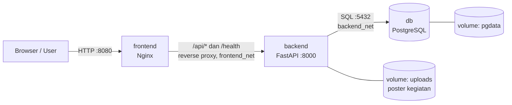

| Service  | Teknologi       | Port host → container | Keterangan |
|----------|-----------------|-----------------------|------------|
| frontend | Nginx + HTML/JS | 8080 → 80             | Menyajikan halaman `/login`, `/register`, `/app`, `/event` dan mem-proxy `/api` ke backend |
| backend  | Python FastAPI  | 8000 → 8000           | REST API, autentikasi JWT, hak akses per peran, unggah poster, proxy geocode, validasi, log, `/health`, `/metrics` |
| db       | PostgreSQL 16   | tidak dipublikasikan  | Data disimpan di volume `pgdata` |

**Komunikasi antarlayanan:** container saling menemukan lewat nama service (DNS internal Docker). Backend memakai `DB_HOST=db`, Nginx memakai `http://backend:8000`. Database hanya ada di jaringan `backend_net`, sehingga tidak bisa diakses langsung dari frontend maupun dari host.

## Halaman

| Alamat | Fungsi |
|--------|--------|
| `/login` | Masuk (satu pintu untuk semua peran, lalu diarahkan ke dasbor) |
| `/register` | Buat akun sebagai Peserta atau Pembuat acara |
| `/app` | Dasbor; isi menu menyesuaikan peran |
| `/event?id=<id>` | Halaman detail kegiatan: poster, peta, ulasan, dan tombol daftar |

## Fitur

**Lokasi berbasis peta (OpenStreetMap).** Pembuat acara mengetik alamat lalu menekan **Cari alamat**; pin otomatis jatuh di titik tersebut. Menggeser pin akan memperbarui alamat lewat *reverse geocoding* — pengguna tidak perlu mengetik koordinat. Koordinat tetap disimpan di database untuk menampilkan peta, tetapi selalu diisi otomatis. Geocoding diproksikan backend ke Nominatim (gratis, tanpa API key) dan disimpan di cache.

**Poster/banner kegiatan.** Gambar diunggah ke volume Docker `uploads` dan disajikan lewat `GET /api/uploads/{nama}`. Divalidasi tipe (JPG/PNG/WEBP/GIF) dan ukuran (maks. 5 MB, dapat diatur `MAX_UPLOAD_BYTES`).

**Pertanyaan pendaftaran fleksibel.** Pembuat acara dapat menambah pertanyaan sendiri per kegiatan (tipe: teks, angka, pilihan, centang) dengan penanda wajib. Jawaban disimpan ternormalisasi dan tampil pada daftar peserta.

**Status & kategori kegiatan.** Setiap kegiatan punya status `draft` / `published` / `cancelled` dan kategori bebas. Peserta hanya melihat kegiatan `published`; kegiatan yang sudah lewat atau dibatalkan tidak bisa didaftari.

**Pencarian, filter, dan halaman.** Daftar kegiatan dapat dicari (nama/lokasi/kategori) dan disaring berdasarkan kategori, rentang tanggal, serta ketersediaan kursi, dengan paginasi. Daftar pengguna juga dipaginasi dan dapat difilter.

**Tiket QR & check-in.** Setiap pendaftaran mendapat kode tiket unik; peserta melihat QR-nya di dasbor. Panitia menandai kehadiran lewat menu **Check-in** dengan memasukkan kode.

**Daftar tunggu.** Saat kuota penuh, peserta dapat masuk daftar tunggu. Ketika ada pendaftaran dibatalkan, kursi otomatis ditawarkan ke antrean paling awal dan email pemberitahuan dikirim.

**Ulasan & rating.** Peserta yang mengikuti kegiatan yang sudah selesai dapat memberi rating 1–5 dan komentar; rata-rata tampil di kartu dan detail kegiatan.

**Ekspor CSV & kalender.** Panitia dapat mengunduh daftar peserta sebagai CSV; setiap kegiatan bisa diunduh sebagai berkas `.ics` untuk ditambahkan ke kalender.

**Notifikasi email.** Email konfirmasi pendaftaran dan pengingat H-1 dikirim bila `SMTP_HOST` diatur; tanpa konfigurasi email hanya dicatat ke log (mode dev).

**Perpanjangan sesi.** Token login diperbarui otomatis di latar belakang lewat `POST /api/auth/refresh` selama pengguna masih membuka aplikasi.

**Mode gelap & aksesibilitas.** Tema terang/gelap mengikuti preferensi sistem dan dapat diubah manual; fokus keyboard, label ARIA, dan `prefers-reduced-motion` diperhatikan.

## Tangkapan layar fitur terbaru

Semua gambar di bawah dibuat otomatis dari aplikasi yang sedang berjalan (folder `docs/fitur/`).

### Masuk dan buat akun
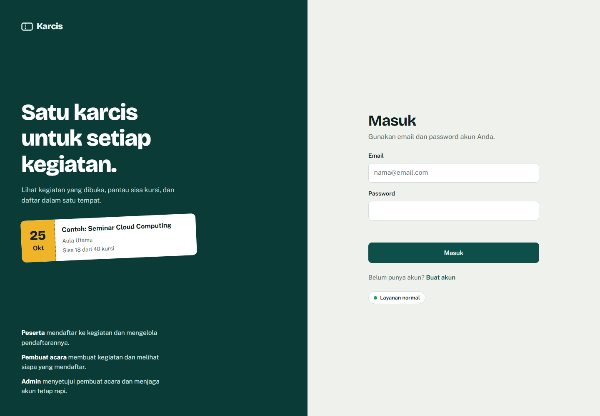
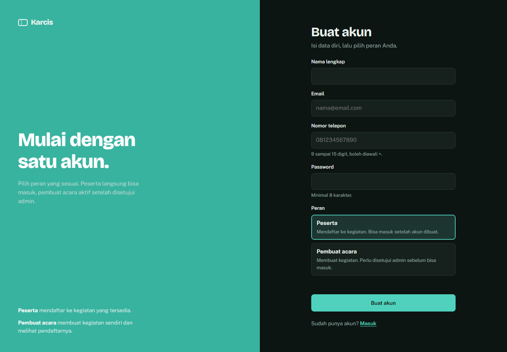

### Peta lokasi di form kegiatan (cari alamat, pin bisa digeser)
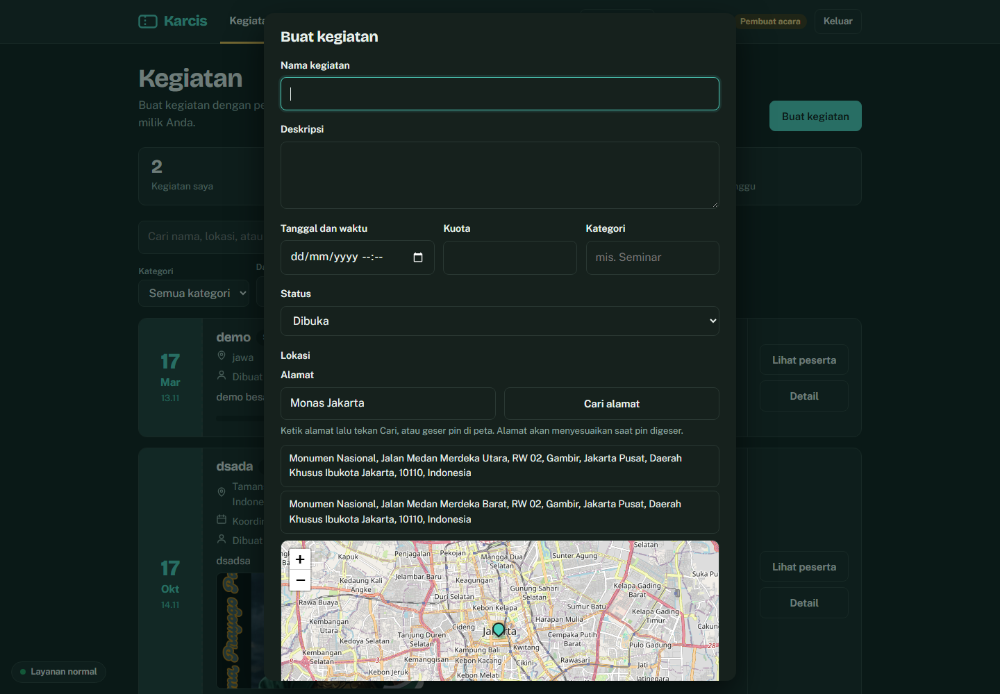

### Dasbor peserta (poster, kategori, filter, sisa kursi)
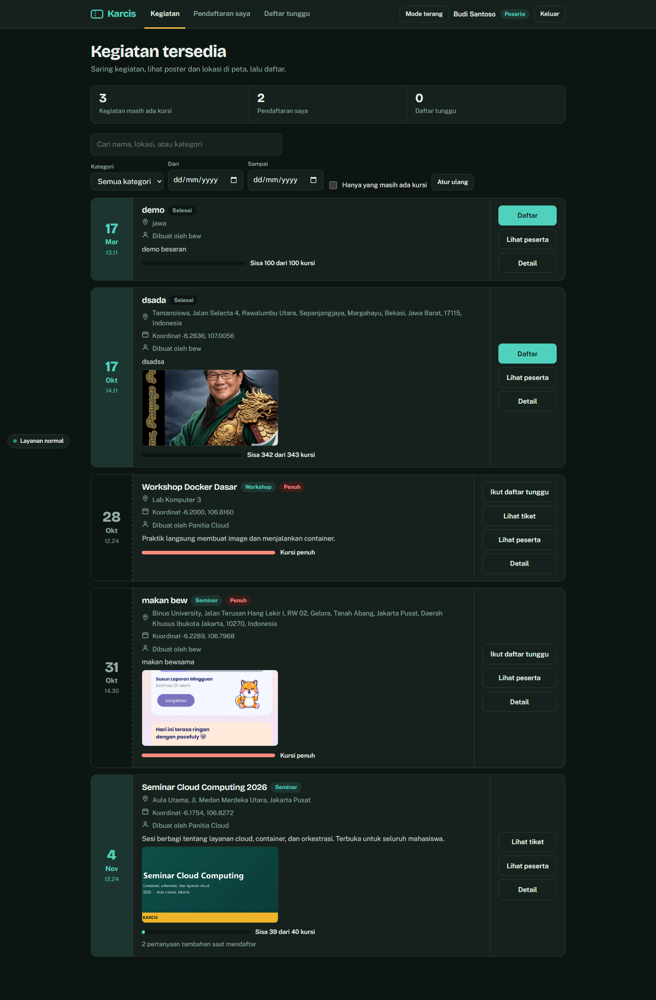

### Halaman detail kegiatan (poster + peta + deskripsi)
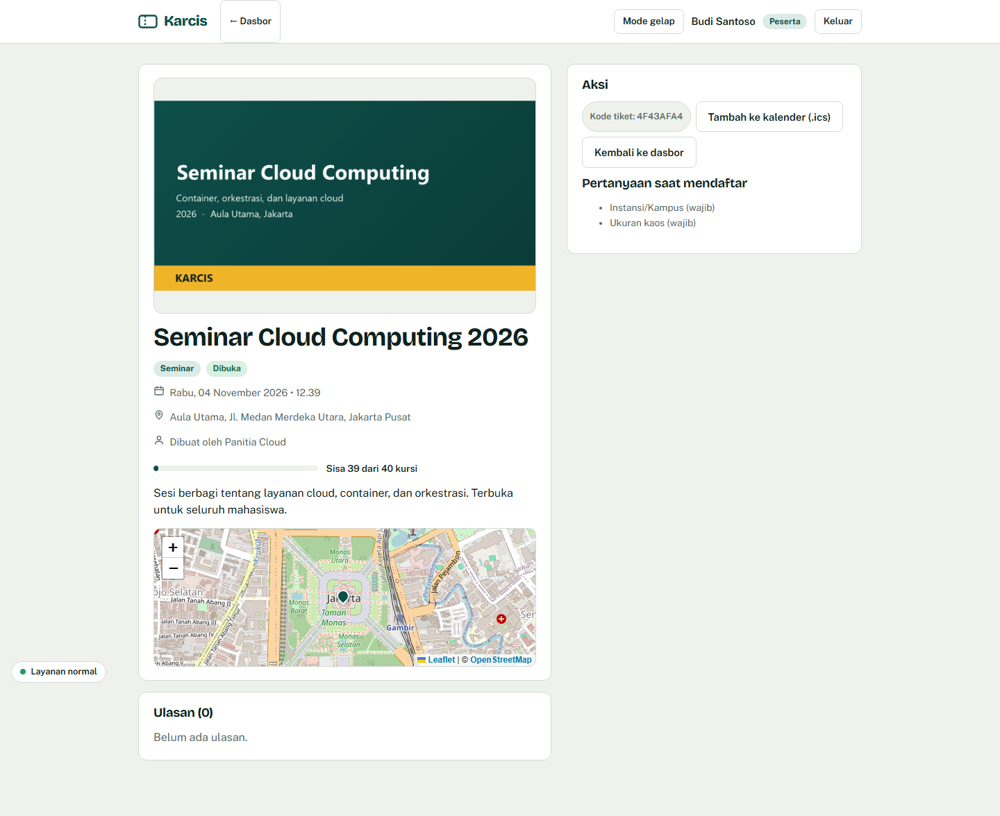

### Tiket QR, daftar tunggu, dan check-in
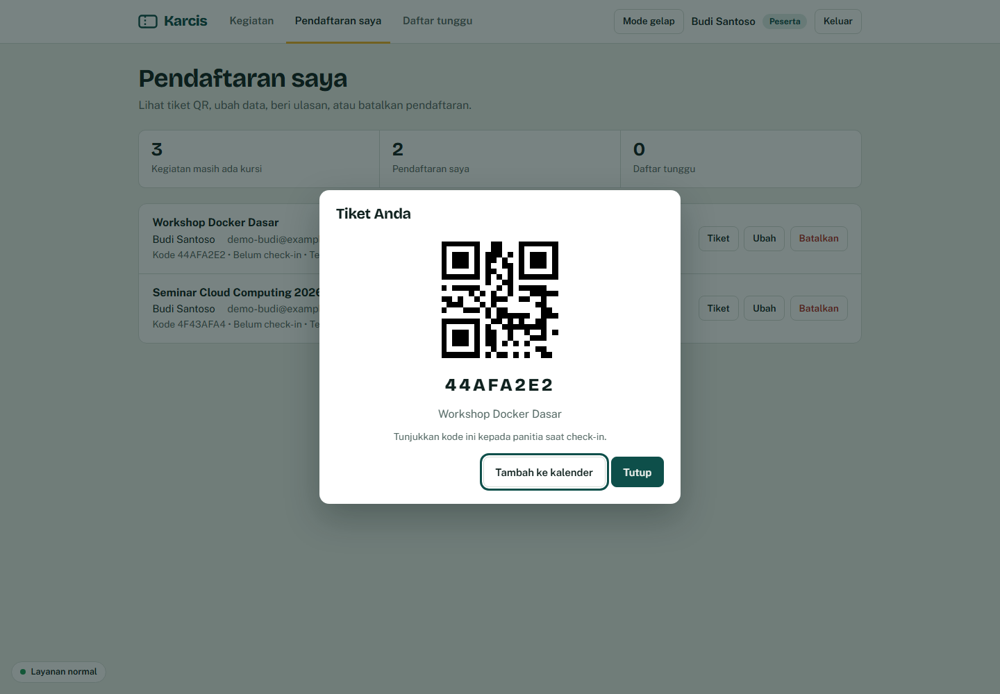
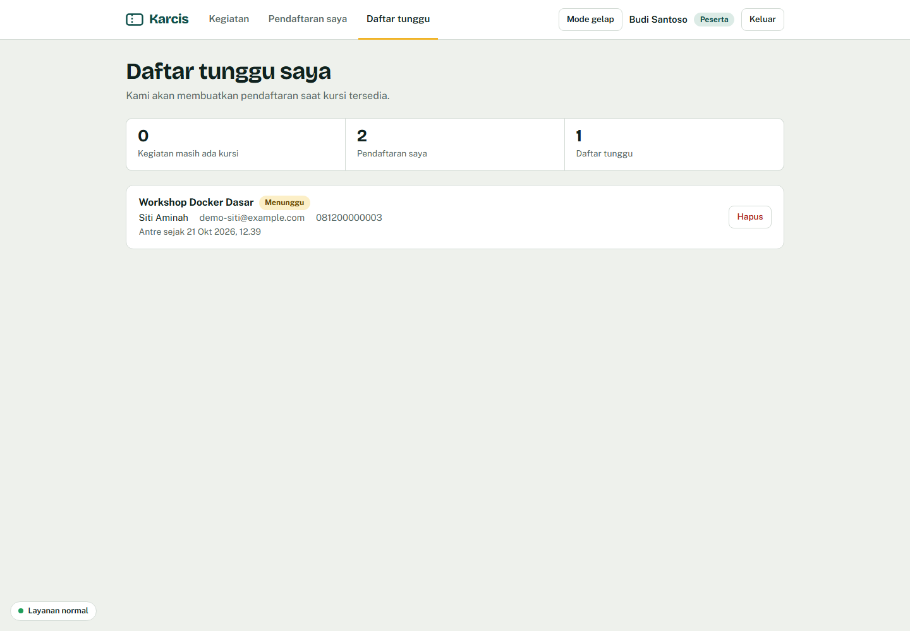
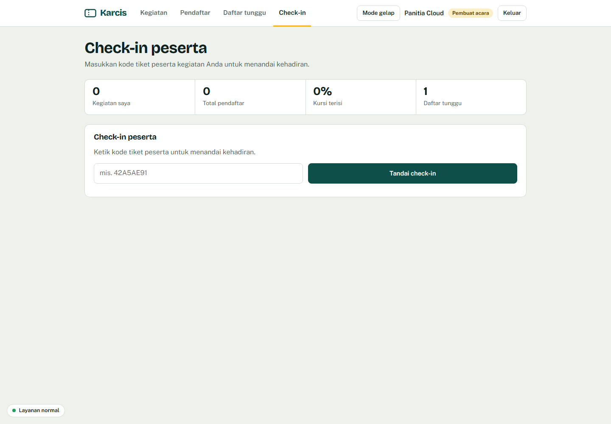

### Mode gelap
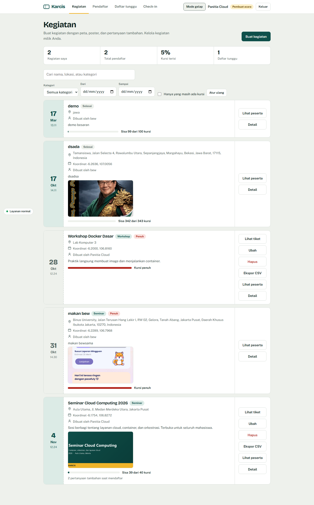

### Bukti penanganan error
| Kasus | Hasil yang diharapkan | Bukti |
|-------|-----------------------|-------|
| Login dengan password salah | 401, "Email atau password salah" | 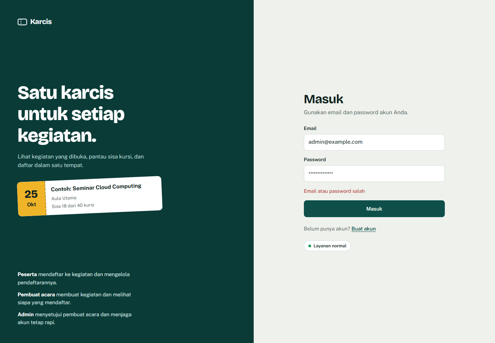 |
| Email tidak valid saat daftar | 422, pesan validasi | 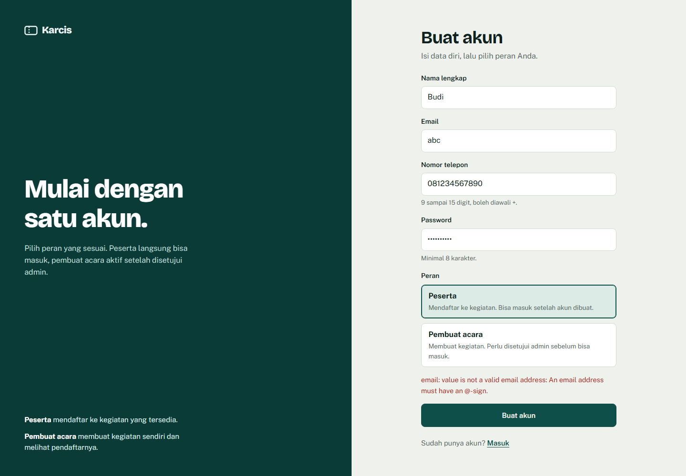 |
| Kode tiket salah saat check-in | 404, "Kode tiket tidak ditemukan" | 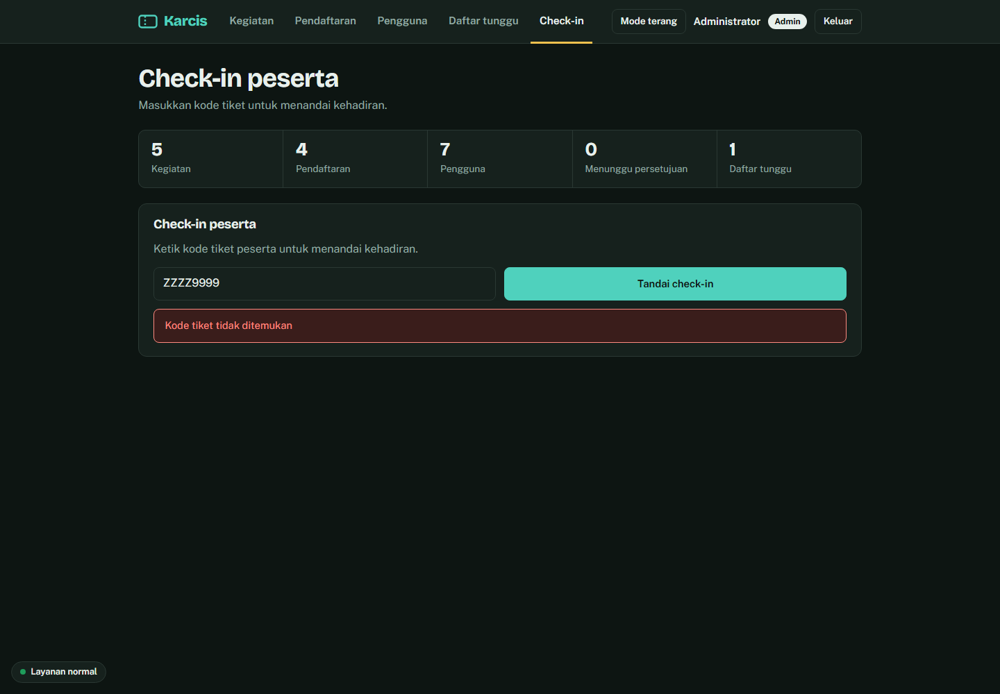 |
| Pendaftaran ganda (email sama) | 409, ditolak | 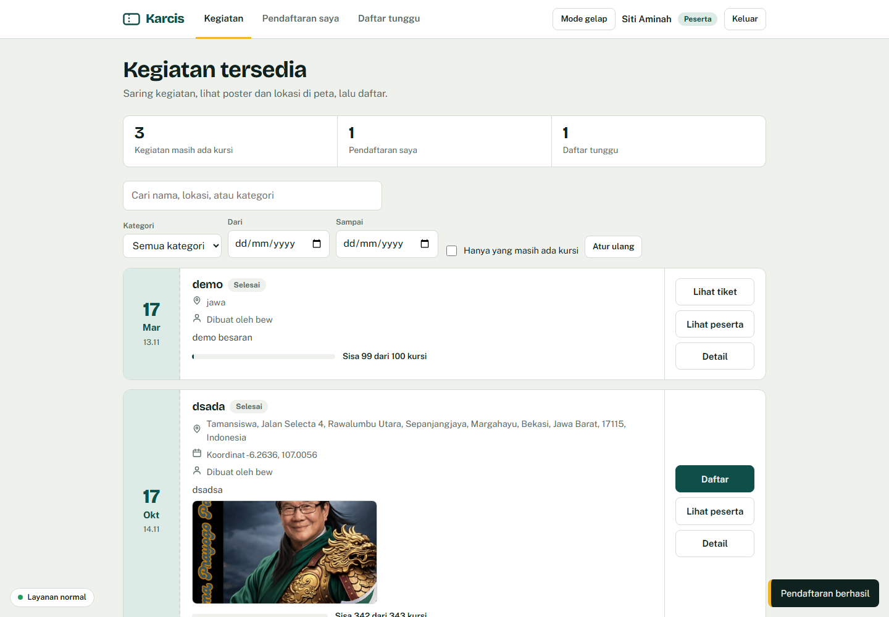 |

## Tampilan aplikasi


### Bukti pengujian

Seluruh screenshot disimpan di folder [`docs/bukti-uji/`](docs/bukti-uji/).

| # | Pengujian | Hasil | Bukti |
|---|-----------|-------|-------|
| 0 | Semua service berjalan | Semua container `healthy` |  |
| 1 | Buat akun peserta | Akun terbuat, bisa masuk |  |
| 2 | Login dengan password salah | 401, "Email atau password salah" |  |
| 3 | Pembuat acara belum disetujui | 403, menunggu persetujuan |  |
| 4 | Persetujuan admin | Pembuat acara bisa masuk |  |
| 5 | Kelola kegiatan | Daftar kegiatan ikut berubah |  |
| 6 | Batas hak akses | 403 |  |
| 7 | Daftar ke kegiatan | Muncul di "Pendaftaran saya", kursi berkurang |  |
| 8 | Ubah dan batalkan pendaftaran | Data berubah, kursi kembali |  |
| 9 | Email tidak valid | 422, data tidak tersimpan |  |
| 10 | Kuota penuh | 409 |  |
| 11 | Pendaftaran ganda | 409 |  |
| - | Akses tanpa login | 401 |  |

## Peran dan hak akses

| Aksi | Admin | Pembuat acara | Peserta |
|------|:-----:|:-------------:|:-------:|
| Lihat daftar kegiatan | ✔ | ✔ | ✔ |
| Buat kegiatan | ✘ | ✔ | ✘ |
| Ubah kegiatan | ✘ | milik sendiri | ✘ |
| Hapus kegiatan | semua | milik sendiri | ✘ |
| Daftar ke kegiatan | ✘ | ✘ | ✔ |
| Ubah data pendaftaran | ✘ | ✘ | milik sendiri |
| Batalkan pendaftaran | semua | pendaftar di kegiatannya | milik sendiri |
| Lihat daftar peserta kegiatan | lengkap | lengkap (kegiatan sendiri), nama saja (lainnya) | nama saja |
| Setujui atau hapus akun | ✔ | ✘ | ✘ |

Alur akun:
- **Peserta** langsung aktif setelah membuat akun.
- **Pembuat acara** berstatus *menunggu persetujuan* dan baru bisa masuk setelah admin menyetujuinya di menu Pengguna.
- **Admin** dibuat otomatis dari `ADMIN_EMAIL` dan `ADMIN_PASSWORD` di `.env`.

## Model data

- `users`: nama, email (unik), telepon, password (di-hash bcrypt), peran (`admin` / `organizer` / `user`), status (`active` / `pending`)
- `events`: nama, deskripsi, tanggal, lokasi (teks alamat), `latitude` + `longitude` (diisi otomatis dari peta), `poster_url`, `category`, `status` (`draft` / `published` / `cancelled`), kuota, `owner_id` (pembuat acara)
- `registrations`: kegiatan, akun pemilik, nama, email, telepon, `code` (kode tiket unik untuk QR), `checked_in_at`. Pasangan `(event_id, email)` unik sehingga pendaftaran ganda ditolak oleh database juga.
- `event_fields`: pertanyaan tambahan per kegiatan (label, tipe, wajib, pilihan, urutan)
- `registration_answers`: jawaban peserta atas pertanyaan tambahan
- `waitlist`: antrean daftar tunggu ketika kuota penuh (status `waiting` / `notified` / `converted` / `cancelled`)
- `reviews`: ulasan dan rating 1–5 per peserta per kegiatan

Skema dibuat otomatis saat backend start dan aman dijalankan ulang. Kolom dan tabel baru (lokasi, poster, status, kategori, pertanyaan tambahan, daftar tunggu, ulasan, kode tiket) ditambahkan lewat `ALTER`/`CREATE ... IF NOT EXISTS`, sehingga database versi sebelumnya dimigrasi otomatis tanpa kehilangan data; `docker compose down -v` tidak wajib.

## Validasi dan aturan bisnis

- Email tidak valid ditolak (422); telepon harus 9–15 digit; password minimal 8 karakter.
- Kuota penuh ditolak (409).
- Pendaftaran ganda (email sama, kegiatan sama) ditolak (409).
- Kuota kegiatan tidak boleh diubah di bawah jumlah peserta saat ini (409).
- Menghapus kegiatan ikut menghapus pendaftarnya; menghapus akun pembuat acara ikut menghapus kegiatannya.
- Pengecekan kuota memakai penguncian baris (`SELECT ... FOR UPDATE`) agar aman saat pendaftaran bersamaan.
- Akses tanpa login ditolak (401); aksi di luar hak peran ditolak (403).

## Operasional

- `/health` memeriksa koneksi database; Compose memiliki `healthcheck` untuk `db` dan `backend`.
- `/metrics` mengekspor metrik gaya Prometheus (jumlah permintaan per rute/status, jumlah kegiatan, uptime). Jalankan Prometheus dengan `docker compose --profile observability up -d` lalu buka http://localhost:9090.
- Log request dan peristiwa penting: `docker compose logs -f backend`.
- Data persisten lewat named volume `pgdata`; poster kegiatan disimpan di volume `uploads`.
- Konfigurasi lewat `.env` (contoh: `.env.example`), tanpa kredensial asli di repository.
- Login dibatasi kecepatannya di Nginx (`limit_req`) untuk mencegah percobaan brute-force; melebihi batas membalas 429.
- Email notifikasi/pengingat aktif bila `SMTP_HOST` diisi; tanpa itu hanya dicatat ke log (mode dev).
- Jika database mati, API membalas 503 dengan pesan jelas dan indikator di UI berubah merah; backend tidak crash.

## Cara menjalankan

Prasyarat: Docker dan Docker Compose terpasang.

```bash
git clone https://github.com/JovanStefanus/event-registration-application
cd event-registration-application
cp .env.example .env        # lalu edit password, JWT_SECRET, dan akun admin
docker compose up -d --build
docker compose ps           # semua service harus running / healthy
```

Buka:
- Aplikasi: http://localhost:8080
- Dokumentasi API (Swagger): http://localhost:8000/docs
- Health check: http://localhost:8080/health

Masuk sebagai admin dengan `ADMIN_EMAIL` dan `ADMIN_PASSWORD` dari `.env`.

Variabel `.env` tambahan yang dapat diatur: `MAX_UPLOAD_BYTES` (batas poster), `PUBLIC_BASE_URL` (tautan pada email), `GEOCODE_URL`/`GEOCODE_USER_AGENT` (peta), `SMTP_*` (email), dan `REMINDER_HOURS` (pengingat H-1).

Monitoring opsional: `docker compose --profile observability up -d` (Prometheus di http://localhost:9090).

Menghentikan: `docker compose down` (data tetap ada). Hapus beserta data: `docker compose down -v`.

## Skenario pengujian

| # | Pengujian | Langkah | Hasil yang diharapkan |
|---|-----------|---------|-----------------------|
| 1 | Buat akun peserta | `/register`, pilih Peserta | Diarahkan ke `/login`, bisa masuk |
| 2 | Login salah | Password salah | Pesan "Email atau password salah" (401) |
| 3 | Pembuat acara belum disetujui | Daftar sebagai Pembuat acara, lalu coba masuk | Ditolak (403) dengan pesan menunggu persetujuan |
| 4 | Persetujuan admin | Admin, menu Pengguna, Setujui | Pembuat acara bisa masuk |
| 5 | Kelola kegiatan | Pembuat acara membuat, mengubah, menghapus kegiatan | Daftar kegiatan ikut berubah |
| 6 | Batas hak akses | Admin memanggil `POST /api/events`; pembuat acara mengubah kegiatan orang lain; peserta memanggil `POST /api/events` | Semuanya 403 |
| 7 | Daftar kegiatan | Peserta memilih kegiatan, Daftar | Muncul di "Pendaftaran saya", sisa kursi berkurang |
| 8 | Ubah / batalkan | Peserta mengubah atau membatalkan pendaftaran | Data berubah / hilang, kursi kembali |
| 9 | Email tidak valid | Isi email `abc` | Pesan error validasi (422), data tidak tersimpan |
| 10 | Kuota penuh | Kegiatan kuota 1, dua peserta berbeda mendaftar | Pendaftaran kedua ditolak (409) |
| 11 | Pendaftaran ganda | Daftar dua kali dengan email sama di kegiatan sama | Ditolak (409) |
| 12 | Persistensi | `docker compose down` lalu `docker compose up -d` | Akun, kegiatan, dan pendaftaran masih ada |
| 13 | Gangguan layanan | `docker compose stop db` | Indikator UI merah, API 503 dengan pesan jelas |
| 14 | Pemulihan | `docker compose start db` | Indikator kembali hijau, aplikasi normal |
| 15 | Cari alamat di peta | Pembuat acara mengetik alamat, tekan Cari, lalu geser pin | Alamat terisi otomatis dari pin (reverse geocode) |
| 16 | Unggah poster | Pembuat acara memilih gambar saat membuat kegiatan | Poster tampil di kartu dan halaman detail |
| 17 | Pertanyaan tambahan | Tambah pertanyaan wajib, lalu peserta mendaftar tanpa mengisinya | Ditolak (422); terisi lengkap lalu berhasil |
| 18 | Kategori & status | Buat kegiatan `draft` lalu lihat sebagai peserta | Kegiatan draf tidak tampil ke peserta |
| 19 | Filter & paginasi | Cari kata kunci, saring kategori/tanggal, pindah halaman | Daftar menyempit dan halaman berpindah |
| 20 | Tiket & check-in | Peserta lihat tiket QR; panitia masukkan kode di menu Check-in | Kehadiran tercatat; check-in ulang ditolak (409) |
| 21 | Daftar tunggu | Kegiatan kuota penuh; peserta ikut daftar tunggu; satu pendaftar membatalkan | Entri antrean berubah menjadi terkonversi |
| 22 | Ulasan | Peserta memberi rating setelah kegiatan lewat | Rata-rata rating tampil di kartu/detail |
| 23 | Ekspor & kalender | Unduh CSV peserta dan berkas `.ics` | Berkas terunduh dengan isi yang benar |

Contoh uji lewat terminal:

```bash
# Email tidak valid -> 422
curl -i -X POST localhost:8080/api/auth/register -H "Content-Type: application/json" \
  -d '{"name":"Budi","email":"abc","phone":"081234567890","password":"rahasia123","role":"user"}'

# Tanpa login -> 401
curl -i localhost:8080/api/events

# Admin tidak boleh membuat kegiatan -> 403
TOKEN=$(curl -s -X POST localhost:8080/api/auth/login -H "Content-Type: application/json" \
  -d '{"email":"admin@example.com","password":"<ADMIN_PASSWORD>"}' | python3 -c "import sys,json;print(json.load(sys.stdin)['access_token'])")
curl -i -X POST localhost:8080/api/events -H "Authorization: Bearer $TOKEN" -H "Content-Type: application/json" \
  -d '{"name":"Uji admin","event_date":"2026-12-01T09:00","location":"Aula","quota":10}'

# Health check dan log
curl -i localhost:8080/health
docker compose logs -f backend
```

Simpan screenshot bukti pengujian di folder `docs/` (mis. `docs/uji-06-hak-akses.png`) dan rujuk di sini.

## Kaitan dengan materi Week 1–7

> Sesuaikan dengan silabus mata kuliah.

| Materi | Penerapan di proyek |
|--------|--------------------|
| Konsep Cloud Services / model layanan | Aplikasi dipaketkan sebagai layanan yang siap di-deploy ke cloud (IaaS/PaaS) |
| Virtualisasi vs container | Tiap komponen berjalan di container terisolasi |
| Docker image dan Dockerfile | `backend/Dockerfile`, `frontend/Dockerfile` |
| Networking container | Jaringan `frontend_net` dan `backend_net`, pemetaan port, reverse proxy Nginx |
| Storage / volume | Volume `pgdata` untuk database dan volume `uploads` untuk poster kegiatan |
| Docker Compose / orkestrasi | `docker-compose.yml`, `depends_on` dengan healthcheck, profil `observability` |
| Konfigurasi dan keamanan | `.env`, tanpa kredensial di repo, password di-hash, JWT, akses per peran, user non-root, DB tidak diekspos, rate limit login |
| Monitoring dan logging | `/health`, `/metrics` gaya Prometheus, Prometheus opsional, healthcheck Compose, log terstruktur |

## Struktur repository

```
.
├── backend/              # FastAPI + Dockerfile
│   ├── main.py
│   ├── requirements.txt
│   └── Dockerfile
├── frontend/             # Nginx + halaman statis
│   ├── index.html, login.html, register.html, app.html, event.html
│   ├── assets/           # style.css, common.js, app.js, event.js
│   ├── nginx.conf
│   └── Dockerfile
├── docs/                 # diagram dan bukti pengujian
├── .github/workflows/    # CI (cek sintaks + build image)
├── prometheus.yml        # konfigurasi scrape opsional
├── docker-compose.yml
├── .env.example
└── README.md
```
